# Asset Management for Odoo 19

> [Baca dalam Bahasa Indonesia](README-id.md)

An Odoo 19 module for running a company's fixed assets end to end: a register with
QR labels, handover to employees, transfers between locations, maintenance, stock
opname (physical counts), disposal, and straight-line depreciation. Every step has
an approval flow and four access levels, from staff who only see what they hold to
managers who sign off disposals.

It runs on **Odoo Community** and depends only on `hr` and `mail`. It does not need
the Enterprise `account_asset` module.

## Features

| Area | What it does |
| --- | --- |
| **Register** | Asset code built from the category prefix (`IT-00001`), category, nested locations (head office › floor, store, warehouse), department, holder, brand/model/serial, condition, photo, notes, chatter. |
| **QR label** | Each asset carries a QR code of its code; print labels three to a row from the asset or the list. |
| **Handover** | An employee requests an available asset → their superior approves → an officer hands it over → the employee asks to return it → the officer receives it and records the condition. Prints a handover record. |
| **Transfer** | Move one or more assets to another location and, optionally, another department, after approval. |
| **Maintenance** | Staff report damage (corrective); officers schedule, run and close the work with vendor and cost, and plan recurring preventive work that reschedules itself. Calendar view. |
| **Stock opname** | Load every asset recorded at a location, mark each found / not found / damaged, validate to update conditions (missing assets become *Lost*). Prints the result. |
| **Disposal** | Sell, scrap or donate an asset after manager approval; the book value is frozen, the gain or loss computed, and the remaining depreciation schedule closed. |
| **Depreciation** | Monthly straight-line schedule down to the salvage value; a daily job posts the lines that fall due, and the book value follows. |

## Installation

The module folder must be named `odoo_asset_management`. Clone it straight into a
directory on your `addons_path`:

```bash
cd /path/to/your/addons
git clone https://github.com/fadjardev/odoo_asset_management.git odoo_asset_management
```

Then, in Odoo:

1. Turn on developer mode (*Settings › Activate the developer mode*).
2. *Apps › Update Apps List*.
3. Search for **Asset Management** and click **Activate**.

Or from the command line:

```bash
odoo -c /etc/odoo/odoo.conf -d <database> -i odoo_asset_management --stop-after-init
```

### With Docker (the official `odoo:19.0` image)

Mount your addons folder on `/mnt/extra-addons`, clone the module into it, and
install it with a second Odoo process. Give that process its own ports, since the
running server already holds 8069 and 8072:

```bash
docker exec odoo-app odoo -c /etc/odoo/odoo.conf -d <database> \
    -i odoo_asset_management --stop-after-init --http-port=8299 --gevent-port=8298
docker restart odoo-app
```

## Configuration

1. **Give people a level.** *Settings › Users*, open a user, and under
   **Asset Management** pick User, Approver, Officer or Manager. The administrator
   is a Manager after install.
2. **Link users to employees.** Approvals follow the HR structure: an employee's
   department (and its manager) and the employee's own manager. A user with no
   employee cannot request a handover.
3. **Categories** (*Assets › Configuration › Categories*): the code is the asset code
   prefix; set the depreciation method and useful life each category defaults to.
4. **Locations** (*Assets › Configuration › Locations*): nest them as deep as you need.
   Searching and counting a location includes everything below it.

## Access levels

Each level includes everything of the level below it.

| Feature | User | Approver | Officer | Manager |
| --- | --- | --- | --- | --- |
| **Assets**: see | the ones they hold, plus every available one | + their departments' and their direct reports' | all | all |
| Assets: register, edit | – | – | ✓ | ✓ |
| Assets: delete | – | – | – | ✓ |
| Asset values (price, book value, depreciation) | hidden | hidden | ✓ | ✓ |
| Print QR label | ✓ | ✓ | ✓ | ✓ |
| **Handover**: request for themselves, ask to return | ✓ | ✓ | ✓ | ✓ |
| Handover: approve / reject | – | for their departments and direct reports | all | all |
| Handover: hand over, receive the return | – | – | ✓ | ✓ |
| **Transfer**: see | – | those touching their departments' assets | all | all |
| Transfer: create, submit, mark moved | – | – | ✓ | ✓ |
| Transfer: approve | – | for their departments' assets | all | all |
| **Maintenance**: report damage | on any asset they can see | same | ✓ | ✓ |
| Maintenance: see reports | their own, and those on assets they hold | + those on their departments' assets | all | all |
| Maintenance: schedule, run, close; preventive plans; vendor and cost | – | – | ✓ | ✓ |
| **Stock opname** | – | – | ✓ | ✓ |
| **Disposal**: propose, carry out | – | – | ✓ | ✓ |
| Disposal: approve | – | – | – | ✓ |
| **Depreciation**: view schedule | – | – | ✓ | ✓ |
| Depreciation: compute schedule | – | – | – | ✓ |
| **Configuration** (categories, locations) | – | – | – | ✓ |

**Who is an approver for what.** "Their departments" means every department the
user heads (*Employees › Departments › Manager*) and every department below it.
For a handover, the approvers are the superiors of the *requesting employee*; for a
transfer, those of the assets being moved. A department head at the top of the tree
therefore approves for the whole company, and a team lead who heads no department
approves for their direct reports only.

The rules are enforced on the server, not just by hiding buttons:

- Record rules limit what each level can read.
- Every workflow action checks the level before it runs.
- The `state` field cannot be written directly, over RPC or otherwise. It only moves
  through the action buttons.
- Value fields carry field-level groups, so staff cannot read them even through the API.

## Workflows

### Asset status

The status of an asset changes only through the documents around it: a handover
puts it in use, a maintenance order takes it out of service and brings it back to
where it was, and an approved disposal removes it from the register.

<picture>
  <source media="(prefers-color-scheme: dark)" srcset="docs/images/asset-status-dark.svg">
  
</picture>

### Handover

<picture>
  <source media="(prefers-color-scheme: dark)" srcset="docs/images/asset-handover-dark.svg">
  
</picture>

### Other documents

| Document | Steps | Who moves it |
| --- | --- | --- |
| Transfer | Draft → Waiting Approval → Approved → Done, or Cancelled before Done | an officer creates, submits and marks it moved; an approver of the assets (or an officer) approves |
| Maintenance | Requested → Scheduled → In Progress → Done, or Cancelled | anyone reports damage; an officer schedules, starts and closes it; finished preventive work schedules its next occurrence |
| Stock opname | Draft → Counting → Validated, or Cancelled | an officer |
| Disposal | Draft → Waiting Approval → Approved → Done, or Cancelled | an officer proposes and carries it out; a manager approves |

## Reports

| Report | From |
| --- | --- |
| QR Label | Asset (form button, or *Print* on a selection in the list) |
| Handover Record | Handover, once handed over |
| Stock Opname Result | Stock opname, while counting or after validation |

## Scheduled actions

| Job | Runs | Does |
| --- | --- | --- |
| Assets: post due depreciation | daily | marks every schedule line dated today or earlier as posted |
| Assets: schedule next preventive maintenance | daily | creates the next occurrence for completed preventive work that has none yet |

## Technical overview

| Model | Purpose |
| --- | --- |
| `asset.asset` | the register |
| `asset.category` | code prefix, depreciation defaults |
| `asset.location` | nested locations (`parent_path`) |
| `asset.depreciation.line` | the monthly schedule |
| `asset.assignment` | handovers |
| `asset.transfer` | transfers |
| `asset.maintenance` | corrective and preventive maintenance |
| `asset.audit`, `asset.audit.line` | stock opname |
| `asset.disposal` | disposals |
| `asset.workflow.mixin` | locks `state` behind the action methods |

```
odoo_asset_management/
├── data/        sequences, scheduled actions
├── docs/        README diagrams (images/) and their Archify sources (diagrams/)
├── models/      the models above
├── report/      QR label, handover record, opname result
├── security/    groups, access rights, record rules
├── static/      app icon
├── tests/       workflow and access-control tests
└── views/       list, form, kanban, calendar and search views, menus
```

### Running the tests

```bash
odoo -c /etc/odoo/odoo.conf -d <test-database> -i odoo_asset_management \
    --test-tags /odoo_asset_management --stop-after-init
```

The 20 tests cover every workflow and the access matrix above. They use their own
records, so they pass on a database that already holds data.

## Requirements

- Odoo 19.0 (Community or Enterprise)
- Modules: `hr`, `mail`
- `wkhtmltopdf` for the PDF reports. It ships with the official Odoo Docker image.

## License

[LGPL-3](LICENSE). See [CHANGELOG.md](CHANGELOG.md) for the release history.
